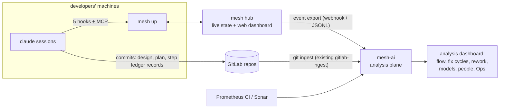

# mesh-harness: journeys, web dashboard, and mesh-ai as the analysis plane

Date: 2026-11-03. Status: **proposal, for discussion**. This document extends [revision 3 of the proposal](2026-11-03-mesh-harness-proposal.md). It covers three things:

1. **Yes, there is a web dashboard** for the live state: tasks in progress, people and agents online, what needs whom.
2. **Every run leaves a trail.** Design, plan (DAG), step records and a ledger are written by the process itself. mesh-ai consumes that trail and becomes the **analysis plane**: how things went, how models behave, fix cycles and rework.
3. **The journeys and use cases**, compared with how developers work today.

---

## 1. Who does what: mesh-harness vs mesh-ai

| | **mesh-harness** (new) | **mesh-ai** (evolved) |
|---|---|---|
| Question it answers | *What is happening right now, and what needs me?* | *How did it go, and what should we change?* |
| Time horizon | Seconds to days (live) | Days to months (history, trends) |
| Users | Developers (terminal view + web), leads approving designs | Leads, owners, the people tuning agents and process |
| Data it owns | Sessions, goals, designs, step DAGs, claims, attention (hub SQLite) | Event store and folds: metrics, Ops (CI/Sonar), activity, routines |
| Writes | Hub state. Each step also commits a **ledger record** into the repo. | Nothing to repos. It is read-only analysis. |
| Interface | `mesh` terminal view, hub **web dashboard**, CLI, 8 MCP tools | mesh-ai dashboard (Metrics, Activity, Ops, Routines, plus new analysis views) |



**Why two systems.** The live tool must stay small and fast, and developers run it themselves. Analysis is heavy, historical and team-wide, and mesh-ai already has most of the machinery for it:

- the event log and zod contract;
- the gateway folds;
- `gitlab-ingest`, which already parses ledger files from repos;
- the Metrics, Activity and Ops views;
- SSO.

mesh-ai stops trying to be the live coordinator. Its programme API, Work view, Needs-you, hooks and MCP server move to mesh-harness in simpler form, or are dropped.

---

## 2. The web dashboard (served by `mesh hub`)

There is one web app on the hub, behind Kanidm sign-in, and it updates live. It is deliberately small: six pages. Each page answers one question.

### 2.1 Live (home): *who is working on what right now, and what's waiting?*

```
mesh · team: dataplane                                              ariel ▾   [Needs attention 3]
──────────────────────────────────────────────────────────────────────────────────────────────────
ONLINE  5 people · 8 machines · 14 sessions   working 7 · needs someone 3 · stalled 1 · idle 3

NEEDS ATTENTION
  ◆ Design ready for approval   G17 IPv6 underlay              owner: ariel        12m   [Review]
  ● Question                    G17.agent  vpc-node-agent      → ariel (owner)      6m   [Open]
  ◌ Stalled 40m (nudged 2/2)    G15.flows  rust-ovs            holder: maria        —    [Open]

ACTIVE GOALS                                       progress        lanes   people
  G17 IPv6 underlay              in progress   ████████░░░░  4/9     2      ariel, tom
  G15 OVS flow offload v2        in progress   ██████████░░  6/8     1      maria
  G19 BMP collector HA           design        —                     —      jon (+1 contributor)
  G12 Gateway MTU fixes          awaiting approval                            sara

PEOPLE ONLINE
  ariel   dev-01, laptop   4 sessions   working 2 · needs you 1 · idle 1
  tom     dev-07           2 sessions   working 2
  maria   laptop           3 sessions   stalled 1 · idle 2
  …
```

- **Needs attention** is computed per viewer. It shows designs you can approve, questions addressed to you, and stalled steps on goals you own. Healthy states take no space.
- **Online** counts only people with `mesh up` connected. A machine shows as online while its daemon is connected.

### 2.2 Goals board: *what is the team working toward?*

Four columns: **Backlog**, **Design**, **Awaiting approval**, **In progress**. A collapsed column holds **Done (last 14 days)**.

Each card shows:

- title, owner and linked GitLab issue;
- a progress bar (steps done out of total);
- the number of lanes;
- avatars of current holders;
- age;
- a red dot if any step is stalled or failed.

From the board you can **create a goal**, **import from GitLab issue**, set priority and assign an owner.

### 2.3 Goal page: *where is this goal, exactly?*

```
G17 · IPv6 underlay                      owner ariel · in progress · plan v2 (approved by sara, 2d ago)
Design: frr-dplane-ovs/docs/design/g17-ipv6-underlay.md  [render]   GitLab: frr-dplane-ovs#123

            ┌───────────┐
            │ proto ✓   │ ariel · 1h10m · MR !41 merged
            └─────┬─────┘
         ┌────────┴─────────┐
   ┌─────▼─────┐      ┌─────▼──────┐
   │ agent ◐   │      │ dplane ✓   │ ariel · 2h05m · 1 fix cycle
   │ tom·dev-07│      └─────┬──────┘
   │ working   │      ┌─────▼──────┐
   └─────┬─────┘      │ dplane-t ● │ ariel · needs you: permission
         └─────┬──────┴────────────┘
         ┌─────▼─────┐
         │ e2e  ○    │ blocked (waits: agent, dplane-t)
         └─────┬─────┘
         ┌─────▼─────┐
         │ docs ○    │
         └───────────┘
```

- **The DAG** renders live, using React Flow reused from mesh-ai `ProgrammeGraph`. Lanes are laid out side by side and the critical path is highlighted.
- **Clicking a step** opens a panel with:
  - the brief;
  - the holder (user · machine · session state · last turn);
  - **notes**, the handoff trail;
  - summary and MR;
  - **step facts**: model, turns, human prompts, nudges, time waiting for a person, fix cycles;
  - buttons: **Claim**, which prints `mesh run <repo> --step G17.agent`, and **Take over**, for paused or stalled steps.
- **Design tab:** the rendered design document, the plan versions and a diff between them, approval history, and **Approve / Revise** buttons for approvers.
- **Timeline tab:** every event for the goal, in order, such as *plan v1 proposed → revised ("split dplane tests") → plan v2 approved → proto claimed by ariel → …*

### 2.4 People: *who is logged in, and what are their agents doing?*

One row per user, with machines, number of sessions and state breakdown. Expanding a user shows their sessions **that hold a step**: repo, step, state, last turn and autopilot level. Sessions without a step are private to their owner (open question Q5 in the proposal). Session content is never shown.

### 2.5 My sessions: *the web version of my terminal view*

This page has the same list as the `mesh` terminal view, but for the signed-in user only. It is served **by the local daemon** at `localhost:7777`, so its **Jump** button can actually switch the tmux window or open `claude attach`. The hub copy of the page shows the same list and offers "copy jump command" instead.

### 2.6 Activity: *what happened today?*

A live, filterable event stream: goals created, plans proposed and approved, steps claimed and done, take-overs, questions raised and answered. It links out to **mesh-ai** for anything historical ("open G17 in Analysis").

**Not in the hub dashboard.** It has no charts over weeks, no model comparisons, no CI or Sonar, no routines. Those live in mesh-ai (§4).

---

## 3. The trail every run leaves (the "ledger")

The process generates its own documentation. Nobody writes progress files or ledgers by hand. Two channels carry it.

### 3.1 In the repo (durable, reviewable, travels with the code)

Paths are relative to the primary repo of the goal. Step records go in the repo where the step ran.

```
docs/design/g17-ipv6-underlay.md         # the design (written by the design session)
.mesh/goals/G17/goal.yaml                # id, title, owner, links (issue, epic)
.mesh/goals/G17/plan.v1.yaml             # proposed DAG, kept even if revised
.mesh/goals/G17/plan.v2.yaml             # approved DAG + approval record (who, when)
.mesh/goals/G17/steps/dplane.md          # one record per step, committed with the step's work
```

A step record is front matter plus a short body. `mesh_done` returns this text, and the agent commits it with its final commit, so it appears in the MR diff.

```markdown
---
goal: G17
step: dplane
kind: implement
repo: frr-dplane-ovs
plan: v2
holders: [{user: ariel, from: 2026-11-03T09:12Z, to: 2026-11-03T11:17Z}]
sessions: [3f2c…]
models: [{model: claude-opus-5-5, effort: high}]
turns: 37
human_prompts: 3          # turns started by a person typing
nudges: 1                 # autopilot nudges needed
waits: {count: 2, minutes: 9}   # time waiting on a person (permission, question)
fix_cycles: 1             # reopened by dplane-t failing once
outcome: done
mr: "!88"
branch: mesh/g17-dplane
---
Added v6 underlay next-hop programming in the OVS bridge; reused the v4 neighbour cache path.
Fix cycle 1: dplane-t showed the ND proxy flag was not set on restart; fixed in commit a1b2c3.
Notes for others: the v4 fallback stays on by default (decided with owner, see G17 timeline).
```

This replaces mesh-ai's hand-maintained `progress/*.md`, `Gate:` lines and `BACKLOG.md` ledger parsing. mesh-ai's existing **git ingest** (`apps/gateway/src/gitlab-ingest.ts`, ledger parser) reads `.mesh/goals/**` in place of `progress/` and `reviews/`.

### 3.2 From the hub (fine-grained, complete)

The hub exports every event (about 15 types: `session.*`, `goal.*`, `plan.*`, `step.*`, `attention.*`, `message.delivered`) to mesh-ai. It can POST each one to mesh-ai's existing `POST /api/events`, with a schema version, or write a nightly JSONL export.

This channel carries what doesn't belong in git:

- exact timestamps of turns, stalls and nudges;
- waiting time;
- take-overs;
- sessions that never completed a step.

**Why both.** The repo trail is what a person reads, and it survives anything. The event stream is what analysis needs for exact timings. Each is useful without the other.

### 3.3 Fix cycles and rework: how they get recorded

These are first-class from the start, so analysis does not have to guess them.

| Signal | How it's produced |
|---|---|
| **Fix cycle (inside the plan)** | A `test` or `review` step that fails calls `mesh_done(outcome: fail, reopen: [dplane], reason)`. The hub reopens `dplane` with the reason as a note and increments its `fix_cycles`. The holder's session is nudged with the failure. |
| **Review cycle (in GitLab)** | MR review rounds (comments, then new pushes) are counted by mesh-ai's GitLab ingest for MRs linked from step records |
| **Design rounds** | Each `mesh revise` creates a new plan version, so `plan.vN` count minus 1 gives the number of rounds |
| **Rework after done** | A later goal or step that touches the same files within N days, or that links to `reworks: G17.dplane` (agents and people can set this in `mesh_plan`), plus reverts of commits from the step's MR. Computed in mesh-ai. |
| **Replan** | `plan.proposed` after approval. Steps dropped or replaced are counted as **plan churn**. |

The `mesh_done` tool from the proposal gains two optional fields, `outcome` (`done` or `fail`) and `reopen` (a list of step ids). That is the only change to the proposal's tool list.

---

## 4. mesh-ai as the analysis plane

### 4.1 What mesh-ai keeps, adds and drops

| Keep | Add | Drop |
|---|---|---|
| Event log + zod contract + gateway folds | Ingest of mesh-harness events (new `harness.*` family) | Programme API (42 operations), leases, MCP server, hooks, `meshctl work`, agent-kit live parts |
| `gitlab-ingest` (commits, ledger parsing) | Parse `.mesh/goals/**` (goal, plan versions, step records) | Work view, Needs-you, Home "live" panels, Mesh View, story FSM |
| Activity, Users | **Flow**, **Quality**, **Models**, **People & attention** views (below) | `BACKLOG.md` / `progress/` / `reviews/` / `Gate:` parsing, once repos move to `.mesh/` |
| Ops (CI from Prometheus + Sonar), Routines, served reports | Links back to the hub Goal page | Demo world, Kafka adapter |
| SSO (switch to Kanidm to match the hub) | | |

### 4.2 Analysis views (new in mesh-ai)

| View | Questions it answers | Main measures |
|---|---|---|
| **Flow** | Where does time go between idea and merge? | Lead time per goal (created → done), time in design, **time awaiting approval**, time per step kind, lane parallelism achieved, critical path versus actual, stall minutes, take-overs |
| **Quality** | How often do we have to redo things? | **Fix cycles** per step and per goal, MR review rounds, **design rounds**, plan churn, **rework rate** (steps reworked within N days), reverts |
| **Models** | How do models and settings behave on our work? | Per model and effort: turns per step, fix cycles, nudges needed, human prompts per step (**autonomy**), stall rate, rework rate, time per step kind. Optional token usage if OTel is turned on. |
| **People & attention** | How much human attention does the system cost, and where? | Waits per goal and step (count, minutes), questions asked versus answered and answer latency, approvals latency, nudges versus interventions, sessions per person, autopilot level in use |
| **Goal retro** | What happened on G17? | One page per goal: the timeline, DAG with actual durations and loops, step records, MR rounds, CI runs, a short generated summary |
| **Ops** (existing) | Are CI and quality healthy? | Unchanged |

Every view filters by team scope, repo, period, model, step kind and person (for person-level views, depending on team agreement).

### 4.3 What this replaces

mesh-ai today spends most of its effort *creating* the data it later analyses: hooks, self-report lines in prompts, ledger conventions and gate records written by hand. In this split:

- **mesh-harness creates the data as a side effect of doing the work.** Claims, done, fail with reopen, revise and approve are the actions people and agents take anyway.
- **mesh-ai only reads and analyses.**

Replay evals (mesh-ai spec 0036) become easier too. Every done goal has a frozen design, plan and step records, which is exactly what an eval case needs.

---

## 5. Journeys and use cases

Each journey shows **today** (tmux plus several `claude` windows) and **with mesh-harness**.

### J1. Morning start: "I have four repos to move forward today"

**Today:** open tmux, create four windows, `cd` into each repo, start `claude`, paste an instruction into each, then start cycling.

**With mesh-harness:**

```bash
mesh run frr-dplane-ovs vpc-node-agent proto-defs rust-ovs
```

Four tmux windows open, each running `claude` in its repo with that repo's `CLAUDE.md`. If any of the user's goals have ready steps in those repos, `mesh` offers them: *"G17.dplane is ready in frr-dplane-ovs. Start it? [Y/n]"*. Accepting sends the step brief as the first prompt. Then **one** window shows the `mesh` terminal view.

**Gain:** set-up is one command, and nobody has to remember what each window should be doing.

### J2. During the day: "Which one needs me?"

**Today:** cycle through windows every few minutes. Some sat waiting for a permission prompt for 20 minutes unnoticed. One finished long ago and is idle. One stopped half-way after saying "Next I'll…" and never did.

**With mesh-harness:**

- **Permission prompt or question:** the terminal view moves that session to **NEEDS YOU** and sends one desktop notification. Press ⏎ to jump to that tmux window, answer Claude in its own interface, and press the jump-back key to return to the list.
- **Stopped half-way:** autopilot `nudge` sends *"Continue with step G17.dplane. If blocked, call mesh_ask; if done, call mesh_done."* The session resumes **without you looking**. After 2 nudges with no progress, it moves to NEEDS YOU.
- **Finished:** with `chain`, it picks up the next ready step in its lane. With `nudge`, it shows ✓ and the step is marked done on the hub.

**Gain:** no round-robin, no stalls left sitting unnoticed, and attention only where it's needed.

### J3. A new feature, design first

1. `mesh goal new "IPv6 underlay" --from gitlab:vpc/frr-dplane-ovs#123`, then `mesh run frr-dplane-ovs --design G17`.
2. Claude reads the issue and the code across repos (`--add-dir` for the related repos, set by `mesh run`), writes `docs/design/g17-ipv6-underlay.md`, and calls `mesh_plan` with a six-step DAG.
3. The approver (or the developer themselves, if they own it) sees **"Design ready for approval"** on the dashboard. They read the design and the rendered DAG, then either:
   - **Revise** ("split dplane tests from the implementation"). The design session receives the comment and proposes plan v2.
   - **Approve.** The steps appear on the Goal page. `proto` is ready.
4. The same session, with `chain`, takes `proto`, then `dplane`, then `dplane-t`… in order. Each finishes with a step record committed in its MR.

**Gain:**

- the process is followed because it is the path of least resistance: there is nothing to implement until the plan is approved;
- the developer never writes a progress file;
- the reviewer approves a plan they can see, not a wall of chat.

### J4. Two people, one goal (parallel lanes)

Ariel is on the `dplane` lane of G17. Tom has spare capacity. He opens the Goal page, sees `agent` is **ready** in a separate lane, and clicks **Claim** (or runs `mesh run vpc-node-agent --step G17.agent`). His session starts with `mesh_context`: the design, the plan, `proto`'s summary and its merged MR.

When `agent` and `dplane-t` are both done, `e2e` becomes ready and is offered to whoever's session is in `vpc-lab`.

**Gain:**

- work splits along the DAG without a meeting;
- each person sees the whole goal live, including who is on what and how far along it is;
- the context comes from the step trail, not from asking the other person.

### J5. Hand-off and take-over: "Maria is out today"

Maria's session on G15.flows ended last night. The step shows **paused · maria · 14h**. Jon runs `mesh take G15.flows`. His session's `mesh_context` returns:

- the brief;
- Maria's notes ("flows table done; the conntrack offload path still fails on ICMP, see test_icmp_offload");
- the WIP branch, which her session pushed when it ended.

Maria gets one notification. The step record will list both holders.

**Gain:** no "can you tell me where you were?" message, and no work stuck behind someone's absence.

### J6. The lead's view: "What is the team doing?"

The lead opens the dashboard's **Live** page and sees:

- 5 people online, 14 sessions;
- one design awaiting their approval;
- one stalled step;
- goals with progress bars.

On the **Goals board**, G12 has sat in *awaiting approval* for two days, so they nudge the owner. On **People**, Tom has three sessions working on G17 and G19.

**Gain:** status without stand-up questions or pinging people, and the lead acts only on what needs them.

### J7. Something is stuck

- **A session stalled after 2 nudges.** It shows in **Needs attention** for the holder and the goal owner. The holder jumps in, sees the agent is blocked on a flaky lab resource, and answers.
- **Working too long.** The transcript stopped changing 25 minutes ago while the session reports working. The row is flagged **quiet**: probably a hung command. One jump shows it.
- **A test step fails.** `mesh_done(outcome: fail, reopen: [dplane])` reopens `dplane` with the failure, and the holder's session is nudged with it. A fix cycle is counted.

**Gain:** stalls are detected and mostly resolved automatically, and every one that needs a person is visible.

### J8. Approving from anywhere

A design is ready while the approver is away from their desk. They open the hub on a phone or browser, read the rendered design and DAG, and approve. The design session (if `chain`) starts the first step immediately.

### J9. Weekly retro, in mesh-ai

The team opens mesh-ai's **Flow** and **Quality** views for the last 2 weeks:

- median lead time 3.1 days, 40% of it *awaiting approval*. The decision: approve designs at the daily sync.
- `test` steps on `frr-dplane-ovs` average 1.8 fix cycles, against 0.4 elsewhere. The decision: improve that repo's `CLAUDE.md` test instructions.
- **Goal retro** for G17 shows the plan was revised once, two take-overs happened, and the `e2e` step waited 6 hours for the lab.

**Gain:** the retro has data without anyone collecting it.

### J10. How do models behave?

mesh-ai's **Models** view compares, by step kind, the models and effort levels people have used:

- **Autonomy:** human prompts per step.
- **Fix cycles.**
- **Nudges needed.**
- **Rework within 14 days.**

For example, high effort on `design` steps cuts design rounds from 1.6 to 0.7. For `docs` steps, the cheaper model shows no difference. The team writes the defaults into `mesh run` profiles.

Later, replay evals can use finished goals as frozen test cases to check this more rigorously.

### J11. Onboarding a new developer

```bash
npm i -g @ours/mesh      # or download the binary
mesh login               # Kanidm
mesh setup               # 5 hooks + MCP + CLAUDE.md block, user-level
mesh up                  # or: mesh up --install (systemd --user / launchd)
```

They keep using tmux and `claude` exactly as before. Their sessions now appear in their terminal view and on the dashboard. **Gain:** three minutes to set up, and no change to how they talk to Claude.

### J12. Solo or offline

With no hub configured, `mesh up` still gives the terminal view, the jump, nudges and local goals stored in a local SQLite file. Connecting a hub later uploads them.

---

## 6. Day in the life: summary of what gets easier

| Pain today | With mesh-harness |
|---|---|
| Cycling through tmux windows to find pending prompts | One list sorted by *needs you*, a notification, one key to jump there and back |
| Sessions stop half-way ("Next I'll…") | Automatic nudge on stall; escalates to you only after 2 tries |
| Remembering what each session was doing | The terminal view shows each session's repo and step; `mesh_context` re-briefs any session |
| Typing "what's next?" into each session | `chain` hands the next ready step to the session automatically |
| Process skipped under pressure | Implementation steps exist only after design approval |
| Coordinating who does what on a shared feature | DAG lanes plus claims visible to everyone |
| Taking over someone's unfinished work | `mesh take` with notes, branch and summary |
| Writing progress files, ledgers, gate notes | Step records are generated and committed with the work |
| Status meetings and pings | Live dashboard: goals, people online, what needs whom |
| Retros and model choices based on impressions | mesh-ai Flow, Quality, Models and People views built from the trail |

---

## 7. Changes to the proposal implied by this document

1. **§6.2 of the proposal** is expanded into the six hub dashboard pages (§2 above).
2. **`mesh_done`** gains `outcome` (`done` or `fail`) and `reopen` (a list of step ids), so fix cycles are recorded (§3.3).
3. **`mesh_done` returns a step record** for the agent to commit, and plans and designs are written under `.mesh/goals/<goal>/` and `docs/design/` (§3.1).
4. **The hub exports events to mesh-ai** (webhook to `POST /api/events` or a JSONL export). mesh-ai adds the `harness.*` event family and the four analysis views (§4).
5. **Roadmap:** the hub dashboard is part of phase 2 (Live, Goals, People, My sessions) and phase 3 (Goal page with DAG and design approval). The mesh-ai analysis changes run in parallel from phase 3, once step records exist.
