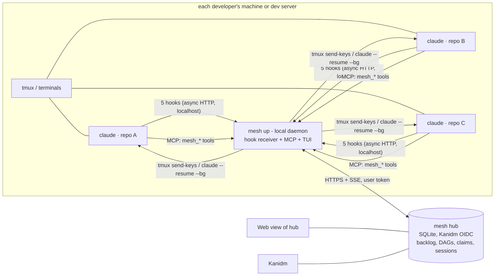
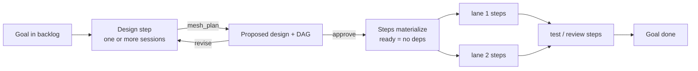

# mesh-harness: a proposal

Date: 2026-11-03. Status: **proposal, revision 3, for discussion**. Companion: [2026-11-03-source-analysis.md](2026-11-03-source-analysis.md), which assesses mesh-ai, deepseek-harness and dsh-superagent-prototype.

## Revision history

| Rev | Change |
|---|---|
| 1 | First proposal: a central control plane, with agents run through the Claude Agent SDK. |
| 2 | Claude Code CLI on subscriptions only. Adds a plugin with many hooks, runner fleets, a workflow engine with five enforcement layers, a quota scheduler and replay evals. |
| 3.1 | Adds the hub **web dashboard** (six pages), the **trail each run commits** (design, plan versions, step records under `.mesh/goals/`), fix-cycle recording (`mesh_done` gains `outcome` and `reopen`), and **mesh-ai repositioned as the analysis plane**. Details and all user journeys: [2026-11-03-journeys-dashboard-and-analysis.md](2026-11-03-journeys-dashboard-and-analysis.md). |
| 3 | **Simplified to match how developers actually work.** Each developer runs mesh-harness on their own machine or server, next to the tmux plus Claude Code sessions they already use. The design now has: **5 hooks, all fire-and-forget**; a small shared **hub** for identity (Kanidm), the common backlog and claims; **SDD as design → approval → a step DAG** whose parallel lanes anyone can pick up; and **no** runner fleets, quota scheduler, tool-level hooks, workflow YAML engine or forge enforcement. Evals, routines and Ops become later add-ons. |

---

## 0. TL;DR

**The problem we're solving.** Today a developer opens tmux and starts several `claude` sessions, usually one per repo. They give each an instruction, then cycle through the windows:

- *Is anything pending here?*
- *Did it stop?*
- *What's next?*
- *Why did this one stall?*

That round-robin is the work mesh-harness removes.

**What mesh-harness is.** It has two small parts:

1. **`mesh`**: one CLI, installed by each developer, with a small local daemon. Running `mesh login` (Kanidm) and `mesh up` gives you:
   - one live list of **your** Claude sessions across repos, sorted by *who needs you*;
   - a one-key jump into the session that needs you;
   - automatic nudging of sessions that stopped mid-step;
   - automatic hand-out of the next step when one finishes.

   It works through **five lightweight hooks**: session start, turn start, turn stop, waiting-for-you, and session end. It also adds a handful of MCP tools the agent calls on purpose.
2. **`mesh hub`**: one small shared server (the same binary in server mode, SQLite by default). It holds:
   - users, from Kanidm;
   - the **common backlog of goals**;
   - each goal's **design and step DAG**;
   - **claims**;
   - a lightweight view of everyone's sessions.

   Several people can then work toward the same goal, pick parallel lanes and continue each other's steps.

**The process (SDD), made simple:**

- A goal starts with **design**.
- When the design is approved, it produces a **DAG of steps**: implement, test, docs, per repo.
- Implementation work **doesn't exist until the design is approved**. That is the enforcement, with no tool-level hooks.
- By default **one agent takes all the steps in order**.
- When the DAG has parallel lanes, other sessions or other people can claim them.
- The graph shows where every goal stands and who is on which step.

---

## 1. What changed from revision 2 and why

| Revision 2 had | Revision 3 | Why |
|---|---|---|
| A central control plane that dispatches agents to runner fleets | **Local-first.** Each developer runs `mesh up` where their sessions are (laptop or dev server). The hub only shares state. | That is how people work today, and it needs no cluster runners or seat pooling. |
| About 15 hook events, including PreToolUse path policy, a long-polled PermissionRequest and Stop exit checks | **5 hooks**, asynchronous HTTP to localhost, never blocking. The one exception is optional message delivery on Stop (§4.4). | Hooks felt heavy; this keeps only start, stop and waiting. |
| A workflow YAML engine, five enforcement layers and a forge status check | **Design gate + DAG.** Steps exist only after the design is approved. Dependencies decide what is ready. | Enforcement by construction is simpler than policing tool calls. |
| A quota-aware scheduler, a capacity view and runner pods | Gone. Each person's sessions run on their own seat. | Not needed for the local-first model. |
| Replay evals, a harness registry and Ops/Routines in the core | **Later add-ons** (§9). The core records step outcomes, which evals can use later. | Keep the core small. |
| Postgres, an object store, OTLP and a React SPA | **SQLite** hub, a terminal UI (TUI), and a small web page served by the hub | Lightweight. |

What survives from revision 2: the Claude Code CLI on subscriptions (no Agent SDK, no API keys), MCP tools for intent, `claude agents --json` where background sessions are used, and GitLab as the place code and MRs live.

---

## 2. Goals and non-goals

**Goals**

1. **G1. My sessions at a glance.** Every Claude session I run, in any repo or tmux window, appears in one list with its state (working, needs you, idle, done, stalled), its repo and its step. Jumping to the one that needs me takes one key.
2. **G2. No babysitting.** When a session stops in the middle of a step, mesh nudges it. When a session finishes a step, mesh gives it the next ready step (if I allow that). When it needs me, I get one notification.
3. **G3. Many agents per person.** `mesh run` starts sessions per repo, each using that repo's `CLAUDE.md`. Several sessions can run at once.
4. **G4. Multi-user toward one goal.** Sessions join under my Kanidm identity. There is a common backlog. Others can see the DAG, claim parallel steps and continue my unfinished ones, with handoff context.
5. **G5. SDD by default.** Design first; approval produces the step DAG; the graph shows progress.
6. **G6. Simple and light.** One binary, 5 hooks, about 8 MCP tools, SQLite, and no daemon beyond `mesh up`.

**Non-goals (core)**

- Replacing the Claude Code terminal UI. You still talk to Claude in its own session. mesh tells you *where* to look and does the routine nudging.
- Policing tool calls, enforcing file-path policy, or approving permissions remotely.
- Running agents for people on shared runner fleets.
- Cost dashboards.
- Replacing mesh-ai Ops and Routines now. They come later as an add-on (§9).

---

## 3. Concepts

These seven concepts are everything a user sees:

| Concept | Meaning |
|---|---|
| **User** | A Kanidm identity (`mesh login`). Every session and claim carries it. |
| **Session** | One Claude Code session (its `session_id`) on a user's machine, in a repo. Its state is derived (§4.3). |
| **Goal** | A backlog item: something we want done. It can be linked to a GitLab issue. It is the unit people talk about. |
| **Design** | The goal's first step: a design document (in the repo or on a design branch) plus a **proposed plan**. It ends at **approval**. |
| **Plan (DAG)** | Steps with dependencies, created from the approved design. Parallel branches are **lanes**. It is versioned, so a re-plan creates a new version. |
| **Step** | One unit of work in the DAG. It has a kind (`implement`, `test`, `review`, `docs`), a target repo, dependencies and a state: `blocked → ready → claimed → done`, or `failed` / `dropped`. A step can be **claimed** by one user's session at a time. When a step is claimed, it records its branch, notes and summary for handoff. |
| **Attention** | Something that needs a person: a session waiting for input or permission, a design to approve, a step that failed or stalled. |

Things deliberately left out: workflows-as-YAML, gates beyond design approval, leases with renewals, tickets/mandates/triggers, programmes, membership protocols and phase labels.

---

## 4. How mesh-harness works with Claude Code

### 4.1 Where things run



- **`mesh up`** is the local daemon, one per user per machine. It:
  - receives the hooks;
  - serves the MCP tools;
  - keeps local session state;
  - nudges and delivers messages;
  - syncs with the hub;
  - serves the TUI (`mesh`) and a local page (`localhost:7777`).

  It works offline: a single-user mode needs no hub at all.
- **`mesh hub`** is a shared server for the team (`mesh hub --db mesh.sqlite`). It handles Kanidm OIDC, the backlog, DAGs, claims, the session registry and the event log, and serves a small web view. One process. SQLite is fine for a team; Postgres is optional.

### 4.2 Starting sessions

People can keep starting Claude however they like. Any session with the hooks installed appears automatically. `mesh run` is a convenience that also makes nudging and delivery fully automatic:

```bash
mesh run frr-dplane-ovs vpc-node-agent proto-defs   # one tmux window per repo, each running `claude` in that repo
mesh run frr-dplane-ovs --step G17.dplane           # start a session already holding a claimed step
mesh run --goal G17 --lanes                         # one session per ready lane of goal G17
```

`mesh run`:

- opens a tmux window (or uses `claude --bg` with `--bg`);
- sets `MESH_STEP` when a step is given;
- names the session (`claude -n "G17.dplane"`);
- records the tmux pane, so mesh can jump to it and type into it later.

Each repo's own `CLAUDE.md` and `.claude/` settings apply as usual. mesh adds nothing to repos.

### 4.3 Hooks: only five, and none block

Hooks are installed once per user, at user level, by `mesh setup` (or as a small `mesh` Claude Code plugin). They are `type: "http"`, posting to `http://127.0.0.1:7777/hook`, with `async: true` where supported. The daemon only records them. A dead daemon never affects the session.

| Hook | Why | What mesh derives |
|---|---|---|
| `SessionStart` | The session exists | Registers the session: user, machine, repo (git remote), cwd, tmux pane, `MESH_STEP` binding |
| `UserPromptSubmit` | A turn started | The session is **working** |
| `Stop` | A turn ended | The session is **idle**. If it holds an unfinished step, it is a stall candidate (§4.5). |
| `Notification` (`permission_prompt`, `idle_prompt`, `agent_needs_input`) | Claude is waiting for the user | The session **needs you** (permission or question) |
| `SessionEnd` | The session is gone | The session is **ended**. Its claims become **paused** (§5.4). |

No `PreToolUse`, `PostToolUse` or `PermissionRequest`: mesh never sees individual tool calls.

**Session state** (per session; the first matching row wins):

| State | Rule |
|---|---|
| `needs-you` | A `Notification` arrived after the last `UserPromptSubmit` |
| `working` | A `UserPromptSubmit` arrived after the last `Stop` |
| `stalled` | `idle` while holding a claimed step that isn't done, for longer than N minutes (default 5) |
| `done` | `idle`, and its step was just reported done |
| `idle` | Otherwise, after a `Stop` |
| `ended` | `SessionEnd` |

**"Working too long."** No tool hooks are needed. The daemon checks the modification time of the session's `transcript_path` (taken from the hook input) every 30 seconds. If that file stops changing while the session is `working` for more than M minutes (default 20), the session is flagged **quiet**. This is a hint, not an action. It is cheap and reads only metadata.

**Background sessions.** For sessions started with `claude --bg`, the daemon also reads `claude agents --json` (Claude Code's supported state interface) to confirm `blocked` / `waitingFor`.

### 4.4 Talking to sessions without visiting them

The daemon delivers a message (a nudge, the next step, or someone's answer) by the first path that applies:

1. **Session about to stop, with a message queued.** The `Stop` hook gets a reply of `{"decision":"block","reason":"<message>"}`, so Claude continues straight away with the message. This works for every kind of session. It is the only hook reply that is not empty, and it is capped at 2 per turn.
2. **Session already idle, started by `mesh run` in tmux.** `tmux send-keys -t <pane> "<message>" Enter`.
3. **Session already idle, a background session.** `claude --resume <session_id> --bg "<message>"`.
4. **Anything else.** Notify the user (TUI badge, desktop notification) with "jump to it".

### 4.5 Autopilot: removing the round-robin

Each session has one setting, which can be changed live in the TUI. The default comes from `mesh run --auto <level>`.

| Level | On `stalled` (stopped with the step unfinished) | On step done | On needs-you |
|---|---|---|---|
| `off` | Badge only | Badge only | Notify |
| `nudge` (default) | Send *"Continue with step X. If you are blocked, call `mesh_ask`; if done, call `mesh_done`."* Up to 2 times, then **needs you** | Badge | Notify |
| `chain` | Same as `nudge` | Claim the **next ready step on the same lane and repo**, and send its brief as the next prompt | Notify |

Permission prompts and questions always go to the person. mesh never approves anything.

### 4.6 MCP tools: the agent's intentional actions

The MCP server is served by the local daemon and declared once in the user's Claude settings by `mesh setup`. It has **eight tools**:

| Tool | Purpose |
|---|---|
| `mesh_context()` | Returns my step (or goal): brief, design link, dependencies' summaries and branches, notes from the previous holder |
| `mesh_next(repo?)` | Lists ready steps that match this repo (or all repos) |
| `mesh_claim(step)` / `mesh_release(step, note)` | Takes or gives back a step |
| `mesh_note(text)` | Records progress or handoff notes on my step (what's done, what's left, gotchas) |
| `mesh_done(summary, branch?, mr?, outcome?, reopen?)` | Finishes my step. Dependents become ready. `outcome: fail` with `reopen: [step…]` reopens earlier steps and counts a fix cycle. Returns the step record for the agent to commit under `.mesh/goals/<goal>/steps/`. |
| `mesh_ask(question)` | Raises an Attention for my user, or for the goal owner if I'm working on someone else's step |
| `mesh_plan(goal, design_doc, steps[])` | **Design sessions only**: proposes the DAG for approval (§5.2) |

There is no self-reporting of "working" or "started": hooks provide that. Agents are told about the tools in one short block, which `mesh setup` adds to the user's `~/.claude/CLAUDE.md`:

> If a mesh step is assigned, start with `mesh_context`. Use `mesh_note` for progress others may need. Finish with `mesh_done`. Ask with `mesh_ask`.

---

## 5. SDD: design → approval → DAG → lanes

### 5.1 Lifecycle of a goal



1. **Goal.** Created in the hub (`mesh goal new "IPv6 underlay"`), or imported from a GitLab issue (`mesh goal new --from gitlab:vpc/frr-dplane-ovs#123`). It lands in the backlog.
2. **Design.** Someone starts it: `mesh run <repo> --design G17`, or claims it with `mesh_claim(G17.design)`. The design step can have **contributors**: other sessions or users working on the same design. For example, one session per affected repo investigates its part. They write to the same design document or branch and share notes, and one session is the owner.
3. **Plan.** The owner session calls `mesh_plan` with the design document and a proposed DAG (example below).
4. **Approval.** The goal owner (or anyone with the `approver` role on the goal) reviews the design document and the rendered DAG in the hub's web view or with `mesh show G17`, then runs `mesh approve G17` or `mesh revise G17 "<comments>"`. A revision goes back to the design session as a message (§4.4). This is the **only human gate** in the core.
5. **Execution.** On approval the steps are created, and those with no dependencies become `ready`.
   - **Default: one agent takes everything.** The design session (or a new one) claims steps in topological order with autopilot `chain`.
   - **Parallel lanes** are visible to everyone. Another session (`mesh run vpc-node-agent --lane G17.agent`) or another person can claim them.
6. **Done.** When every step is done or dropped, the goal is done. A linked GitLab issue gets one closing comment.

Example `mesh_plan` payload. The agent writes it and the hub stores it; nobody edits YAML by hand:

```yaml
goal: G17
design: frr-dplane-ovs@design/g17-ipv6-underlay:docs/design/g17-ipv6-underlay.md
steps:
  - id: proto      ; repo: proto-defs      ; kind: implement ; title: "Add v6 underlay fields"
  - id: agent      ; repo: vpc-node-agent  ; kind: implement ; deps: [proto]
  - id: dplane     ; repo: frr-dplane-ovs  ; kind: implement ; deps: [proto]
  - id: dplane-t   ; repo: frr-dplane-ovs  ; kind: test      ; deps: [dplane]
  - id: e2e        ; repo: vpc-lab         ; kind: test      ; deps: [agent, dplane-t]
  - id: docs       ; repo: vpc-docs        ; kind: docs      ; deps: [e2e]
```

The lanes here, `agent` and `dplane → dplane-t`, are simply the parallel branches of the DAG.

### 5.2 Why this is "enforced" without being heavy

- **There are no implementation steps before approval.** `mesh_next` cannot offer what doesn't exist, and agents briefed through mesh work from steps.
- **Dependency order is structural.** A step is `ready` only when its dependencies are `done`.
- **A design change means a new plan version.** `mesh replan G17` reopens the design. Steps already done stay done, steps not yet started are replaced, and claimed steps are flagged for their holders.
- **Nothing stops a developer from working outside mesh.** That work is simply not on the graph. If teams later want a hard stop, an optional GitLab MR check ("branch belongs to a done-or-claimed step of an approved plan") can be added (§9). It is not in the core.

### 5.3 Rendering

- **Goal page** (hub web view, and `mesh show G17` in the terminal). The design document link, then the DAG:
  - nodes coloured by state;
  - for each claimed node: the holder (user · machine · session state, such as *ariel · dev-01 · working*);
  - for each done node: its summary and MR;
  - lanes laid out side by side;
  - the critical path highlighted.
- **Backlog.** Goals with status (`design`, `awaiting approval`, `in progress` with `n/m steps`, `done`), owner and number of active sessions.

### 5.4 Multi-user: claims, handoff and continuing someone's work

- **Claims are per step**, held by `user + session`. The hub shows them to everyone.
- **When a session ends**, its claims become `paused` and keep the holder. The holder can resume from any session with `mesh_claim`.
- **A paused or stalled claim older than T** (default 4 hours, configurable per goal) can be **taken over** by anyone with `mesh take G17.dplane`. The new holder's `mesh_context` returns:
  - the step brief;
  - the previous holder's notes and last summary;
  - the branch name (pushed state: mesh asks agents to push their WIP branch on `mesh_note` / `mesh_release`).

  The previous holder gets one notification.
- **Questions on someone else's step.** `mesh_ask` goes to the goal owner or the step's previous holder.
- **Visibility.** The hub shows every user's sessions *that hold steps*: repo, step, state and last-turn time. It never shows content. Each person's TUI also shows their sessions with no step, but those stay local unless the person shares them.

---

## 6. What users see

### 6.1 TUI: `mesh` (the tmux replacement for "where do I look?")

```
mesh · ariel@dev-01 · hub: ok                                     [a]utopilot  [n]ext  [g]oals  [?]
NEEDS YOU (2)
  ● frr-dplane-ovs   G17.dplane    permission: Bash(make install)                     2m   ⏎ jump
  ● vpc-node-agent   G17.agent     question: "keep v4 fallback on by default?"        6m   ⏎ jump
WORKING (2)
  ◐ proto-defs       G17.proto     turn 14 · 3m                                        chain
  ◐ vpc-lab          —             turn 2 · 40s                                        off
STALLED / QUIET (1)
  ◌ rust-ovs         G15.flows     stopped with the step open · nudged 1/2 · 7m        nudge
DONE (1)
  ✓ frr-dplane-ovs   G17.design    plan proposed → awaiting approval (owner: ariel)
```

- **⏎ Jump** switches to the tmux window (`tmux switch-client` / `select-window`), or runs `claude attach <id>` for background sessions. You answer Claude in its own interface, then press a key to come back.
- **Other keys:**
  - `s`: send a message to a session (delivered as in §4.4);
  - `a`: change autopilot;
  - `n`: start a session on the next ready step;
  - `g`: browse goals and DAGs.

### 6.2 Hub web dashboard (team)

The hub serves a live web dashboard behind Kanidm sign-in. It has six pages:

- **Live** (home): who is online, sessions by state, what needs attention, active goals.
- **Goals board:** Backlog, Design, Awaiting approval, In progress, Done.
- **Goal:** design, DAG with holders and step facts, timeline, approve/revise.
- **People:** each user's machines and their sessions that hold steps.
- **My sessions:** the terminal view in a browser, with a working jump button when served by the local daemon.
- **Activity:** a live event stream.

Wireframes and details are in [2026-11-03-journeys-dashboard-and-analysis.md §2](2026-11-03-journeys-dashboard-and-analysis.md). Historical analysis (flow, fix cycles, rework, model behaviour) lives in **mesh-ai**, which consumes the hub's events and the trail committed to repos (same document, §§3–4).

### 6.3 CLI (everything is scriptable)

```bash
mesh login                       # Kanidm OIDC (browser / device code), stores token
mesh setup                       # installs the 5 hooks + MCP server + CLAUDE.md block (user-level)
mesh up                          # local daemon (also: systemd --user / launchd unit)
mesh                             # TUI
mesh run <repo...> [--step|--lane|--design] [--auto off|nudge|chain] [--bg]
mesh goal new "<title>" [--from gitlab:<proj>#<n>]
mesh show <goal>                 # DAG in the terminal
mesh approve <goal> | mesh revise <goal> "<comments>"
mesh next [--repo R]             # list ready steps
mesh take <step>                 # take over a paused/stalled step
mesh say <session|step> "<msg>"  # deliver a message
mesh hub [--db path]             # run the shared hub
```

---

## 7. Architecture and tech

| Part | Choice | Notes |
|---|---|---|
| Language | TypeScript on Node 22, a single package; or Go for a static binary (open question Q1) | One codebase for CLI, daemon and hub |
| Local daemon | HTTP on `127.0.0.1:7777` (hooks, MCP over streamable HTTP, local page), SQLite file in `~/.local/state/mesh` | Spools hub-bound events when offline |
| Hub | HTTP JSON API + Server-Sent Events, **SQLite** (WAL), event log table + current-state tables | One process. Back up the file. Postgres adapter only if needed. |
| Auth | Kanidm OAuth2/OIDC. CLI login with PKCE and a localhost callback (device code if our Kanidm version supports it). The hub validates tokens against Kanidm's JWKS. Roles (`member`, `approver`, `admin`) come from Kanidm groups. | Replaces mesh-ai's Keycloak setup. Same pattern (local JWT check, CLI login). |
| Claude Code surfaces used | `claude`, `claude -n`, `claude --bg`, `claude --resume --bg`, `claude attach`, `claude agents --json`; 5 hooks; MCP | All documented. No Agent SDK and no API key: everything runs on each user's own subscription login. |
| tmux | Optional. Used by `mesh run` and for jump and delivery. | Without tmux, the same works with background sessions. |
| GitLab | Optional: import a goal from an issue, post one comment on approve and on done, link MRs reported in `mesh_done` | Thin. Uses mesh-ai's `packages/source` client. |

**Hub data model** (SQLite tables): `user`, `machine`, `session`, `goal`, `plan(version, approved_by, approved_at)`, `step(id, goal, plan_version, kind, repo, deps, state, holder_user, holder_session, branch, summary)`, `note`, `attention`, `event(seq, ts, type, user, session, goal, step, payload)`.

**Events** (about 15 types): `session.started|turn_started|turn_stopped|waiting|ended`, `goal.created|done`, `plan.proposed|approved|revised`, `step.ready|claimed|noted|released|done|failed|taken_over`, `attention.raised|resolved`, `message.delivered`.

---

## 8. Keep, reuse and drop from mesh-ai (and the other sources)

| From | Keep or reuse | Drop |
|---|---|---|
| **mesh-ai** | The idea of agents reporting through **MCP**. The **Stop-hook** pattern (now also used for delivery). Login with a local JWT check (ADR-0023 pattern, now Kanidm). The idea of `worker spawn` (now `mesh run`). GitLab client (`packages/source`). The SDD role agents' content, offered as optional skills (`/mesh-design`, `/mesh-step`). DAG rendering with React Flow (`ProgrammeGraph`) for the goal page. | 42-op programme API, leases/epochs, joins/grants/P0, telemetry hooks + daemon + reapers, story FSM, gateway/Kafka/NATS/Postgres projection, dashboard views beyond the three above, `BACKLOG.md` ledgers and id reservation, GATE-1 process |
| **dsh-superagent** | **"Take as little human attention as possible"**: one notification, labels that say who a row waits for, healthy states take no space. The ordered state classification (now per session). Router/worker separation, as a mindset: the human approves the design, agents execute steps. Handoff by recorded notes, not memory. | Triggers/Eval/Mandates/admission tables, effects/outbox machinery, a router LLM session |
| **deepseek-harness** | Durable events plus live view; projections over an event log (much smaller here) | Everything runtime-specific |

---

## 9. Later add-ons (not in the core)

Each add-on plugs into the same hub and events, and each is optional:

1. **Analysis in mesh-ai.** This replaces the earlier idea of building analytics into mesh-harness. Every step already records: holder, model (from the `SessionStart` hook input), wall time, number of turns (from start/stop hooks), nudges needed, human prompts, waits, fix cycles and handoffs. The hub exports its events to mesh-ai, and mesh-ai's git ingest reads the committed `.mesh/goals/**` trail. mesh-ai then provides the Flow, Quality, Models and People views. Token usage can be added through Claude Code's OpenTelemetry export if wanted, and replay evals (mesh-ai spec 0036) can follow later. See [the journeys document §4](2026-11-03-journeys-dashboard-and-analysis.md).
2. **Routines and Ops.** These stay in mesh-ai, which keeps its CI/Sonar Ops view and routines.
3. **GitLab MR guard.** An optional external status check: "this branch belongs to a step of an approved plan".
4. **Auto-pull.** Idle sessions with autopilot `chain` and no step may claim ready steps in their repo from any goal. It is opt-in per user.
5. **Plugin packaging.** Ship hooks, MCP and skills as a `mesh` Claude Code plugin instead of `mesh setup` writing user settings.

---

## 10. Roadmap

| Phase | Scope | Done when |
|---|---|---|
| **1. Local** (1–2 weeks) | `mesh setup`, `mesh up`, 5 hooks, session state, transcript quiet detection, TUI with jump, `mesh run` (tmux), delivery (Stop block, send-keys), autopilot `nudge` | A developer replaces tmux round-robin for a week |
| **2. Hub** (2–3 weeks) | Kanidm login, hub with SQLite, goals and backlog, steps and claims, MCP tools, `chain` autopilot, People page | Two developers run one goal with a manual DAG in parallel lanes |
| **3. SDD** (2 weeks) | Design step with contributors, `mesh_plan`, approve/revise, DAG rendering (TUI + web), replan, take-over and handoff notes | A goal goes from design to approval to DAG to done, with one lane taken over by a second person |
| **4. Analysis + add-ons** | Hub event export, and mesh-ai changes: the `harness.*` event family, `.mesh/goals/**` ingest, Flow/Quality/Models/People views. Also GitLab import and comments, and optional OTel. | A retro run in mesh-ai entirely from the trail of real goals |

**Things to verify first** (each takes a day or less):

1. A `Stop` hook HTTP reply with `decision: block` reliably delivers a message and continues the turn, with the cap of 2.
2. `Notification` matchers (`permission_prompt`, `idle_prompt`, `agent_needs_input`) fire for terminal sessions in our Claude Code version.
3. The hook input carries `session_id`, `cwd` and `transcript_path` for all five events.
4. `claude --resume <id> --bg "msg"` delivers to an idle background session.
5. Kanidm OIDC with PKCE localhost callback from the CLI, and the device-code flow if available.

---

## 11. Open questions

| # | Question | Proposed default |
|---|---|---|
| Q1 | TypeScript or Go for the single binary? | TypeScript (reuses mesh-ai code), packaged as a Node single-executable application (SEA) |
| Q2 | Default autopilot level? | `nudge`; `chain` opt-in per session |
| Q3 | Stall threshold and take-over threshold? | 5 minutes stalled; 4 hours for take-over |
| Q4 | Where design documents live | In the primary repo on a `design/<goal>` branch, merged with the first step |
| Q5 | Do users share sessions that hold no step with the hub? | No; local only |
| Q6 | Who can approve a design? | The goal owner, plus members of the Kanidm group `mesh-approvers` |
| Q7 | Is GitLab the backlog, or is the hub? | **The hub holds goals.** GitLab issues can be imported and linked. That keeps the core independent and fast. |
